  

### About

I'm Saman, a full-stack developer focused on backend engineering,
clean APIs, and practical business applications.
I'm expanding my skills in DevOps and deployment automation.
Outside of code, I enjoy beatboxing and video editing.

  

  

  <a href="https://github.com/Samanbanafshekhah?tab=repositories">Explore my projects ↗</a>

