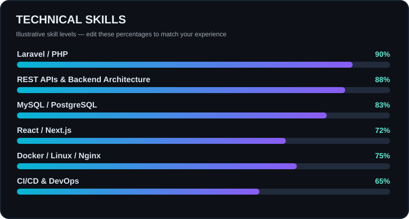

<div align="center">

# Hey, I'm Saman 👋


**Building reliable systems, clean APIs, and production-ready applications.**


</div>

---

### 👨‍💻 About Me

I'm a full-stack developer with a backend focus. I work on **Laravel/PHP applications, REST APIs, database-driven platforms, authentication, business workflows, and production deployments**. I also build with **React and Next.js** when projects need frontend work.

I enjoy taking complicated real-world requirements and turning them into practical, maintainable software.

### ⚡ Skill Levels



### 🛠 Tech Stack

<div align="center">

**Backend & Data**


**Frontend**


**DevOps & Tools**


</div>

### 🚀 What I Build

| Area | What I work on |
|:--|:--|
| 🏢 **Enterprise & Government Systems** | Organization workflows, role-based access, reporting, complex business logic, integrations |
| 🛒 **E-Commerce** | Products, inventory, pricing, purchase flows, admin dashboards, permissions |
| 🪙 **Gold Trading Platform** | Live price updates, buy/sell flows, pricing rules, trading limits, PWA dashboards |
| ⚙️ **Deployment & Infrastructure** | Linux servers, Docker, Nginx/Apache, CI/CD, monitoring and maintainability |

### 🌱 Currently Leveling Up

```text
DevOps journey
├── Docker & containerization
├── CI/CD pipelines
├── Jenkins
├── Ansible
├── Prometheus & monitoring
└── Production infrastructure
```

### 🎧 Beyond the Terminal

🎤 Beatboxing · 🎧 DJing & music discovery · 🎬 Video editing · 🎥 Content creation

> Code and music are two different ways I like building things from scratch.

### 💭 How I Build

```php
while ($problemExists) {
    understand();
    build();
    test();
    improve();
}
```

<div align="center">

### Let's build something useful. 🚀


</div>
